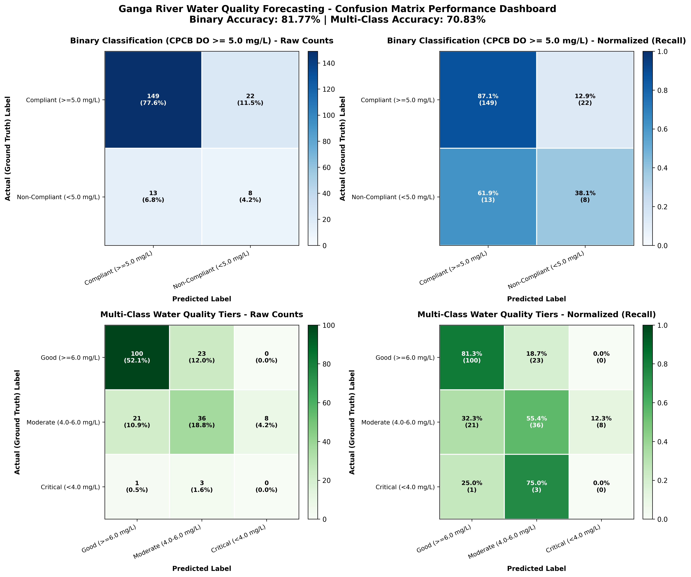

# Ganga Water Quality Forecasting 🌊

Machine Learning and Deep Learning pipeline for forecasting and classifying water quality parameters along the River Ganga across multiple monitoring stations in Uttarakhand (UK), Uttar Pradesh (UP), and West Bengal (WB).

---

## 📌 Project Overview
Water quality forecasting along the Ganga river basin is crucial for ecological preservation, public health, and regulatory compliance. This project predicts key river health indicators:
- **Dissolved Oxygen (DO)** (mg/L) – primary indicator of aquatic life survival and ecological health.
- **Biochemical Oxygen Demand (BOD)** (mg/L) – measure of organic pollution.
- **pH** – acidity/alkalinity balance.

---

## 📊 Confusion Matrix & Classification Analysis
In addition to continuous numerical forecasting, the model evaluates regulatory compliance and ecological thresholds set by the **Central Pollution Control Board (CPCB, India)** using Confusion Matrix analysis:

### 1. Binary Water Quality Compliance (CPCB Bathing / Class B Standard)
- **Compliant / Fit ($\text{DO} \ge 5.0\text{ mg/L}$)**: Water meets the minimum dissolved oxygen threshold for outdoor bathing and healthy aquatic ecosystems.
- **Non-Compliant / Critical ($\text{DO} < 5.0\text{ mg/L}$)**: Hypoxic conditions indicating pollution and requiring mitigation.

### 2. Multi-Class Ecological Tiers
- **Good / Pristine**: $\text{DO} \ge 6.0\text{ mg/L}$ (Class A drinking water standard without conventional treatment)
- **Moderate / Acceptable**: $4.0 \le \text{DO} < 6.0\text{ mg/L}$ (Class B/C outdoor bathing and wildlife propagation)
- **Critical / Impaired**: $\text{DO} < 4.0\text{ mg/L}$ (Severe oxygen depletion / Below Class D)

### Confusion Matrix Performance Dashboard
The pipeline generates:
- **Raw Count Confusion Matrices**: Displays exact counts of True Positives, True Negatives, False Positives, and False Negatives.
- **Normalized Confusion Matrices (Recall)**: Assesses per-class detection sensitivity.
- **Performance Metrics**: Accuracy, Precision, Recall / Sensitivity, Specificity, and F1-Score.



---

## 🚀 How to Run

### Run the Confusion Matrix Pipeline
```bash
python confusion_matrix.py
```
This evaluates the model, prints classification reports, and outputs `confusion_matrix_results.png`.

### Run the Full ML Forecasting Pipeline
```bash
python "ganga ml.py"
```

---

## 📈 Machine Learning Models Included
- **Gradient Boosting Regressor & Classifier**
- **Random Forest & Bagging Regressors**
- **Pruned Decision Trees**
- **Linear Models with Syllabus Optimizers**: Conjugate Gradient (L2), Subgradient Method (L1), Stochastic Gradient Descent, Newton's Method, Coordinate Descent, and Differential Evolution
- **1D CNN with Activation Function Benchmarking** (ReLU, Sigmoid, etc.)

---

## 📜 License
This project is licensed under the MIT License - see the [LICENSE](LICENSE) file for details.
